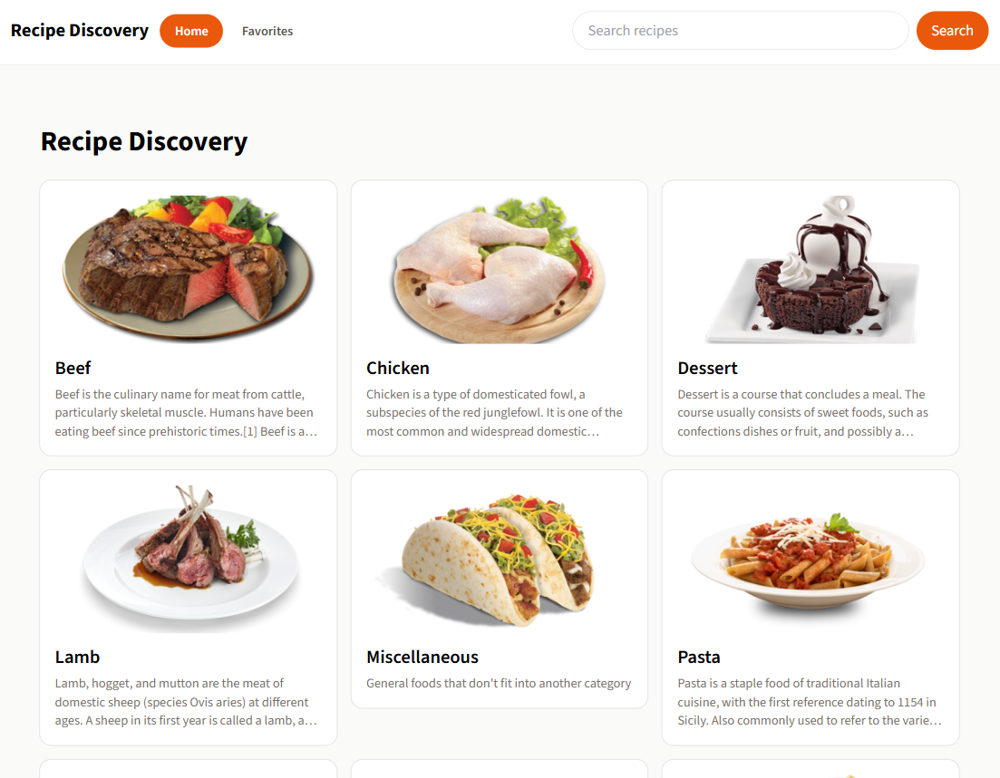
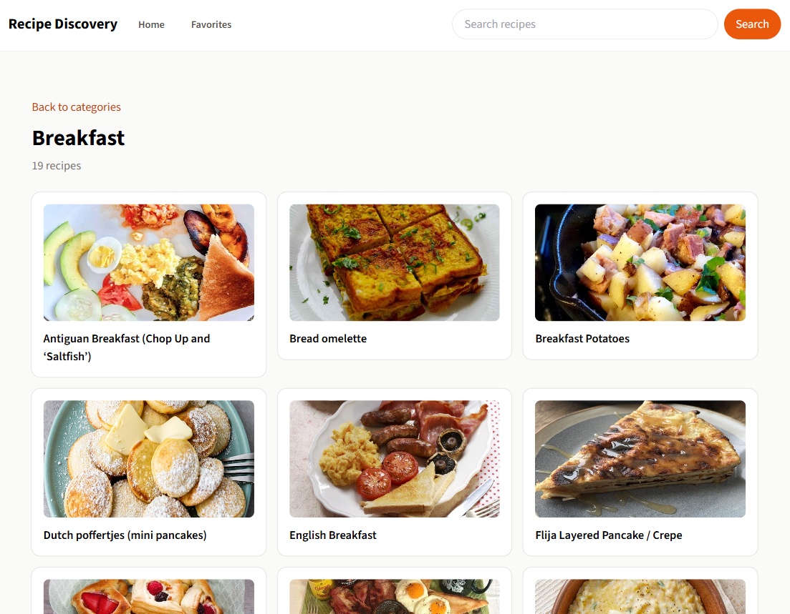
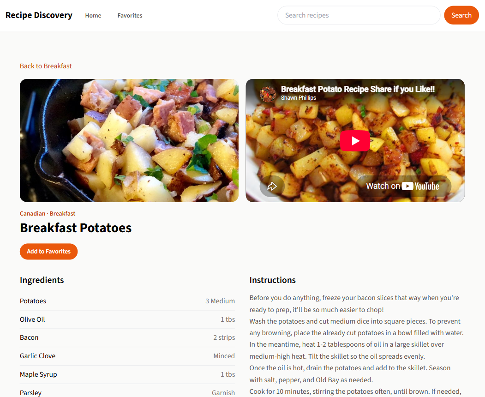
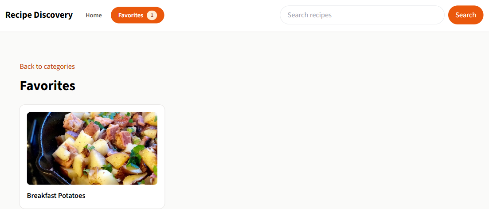
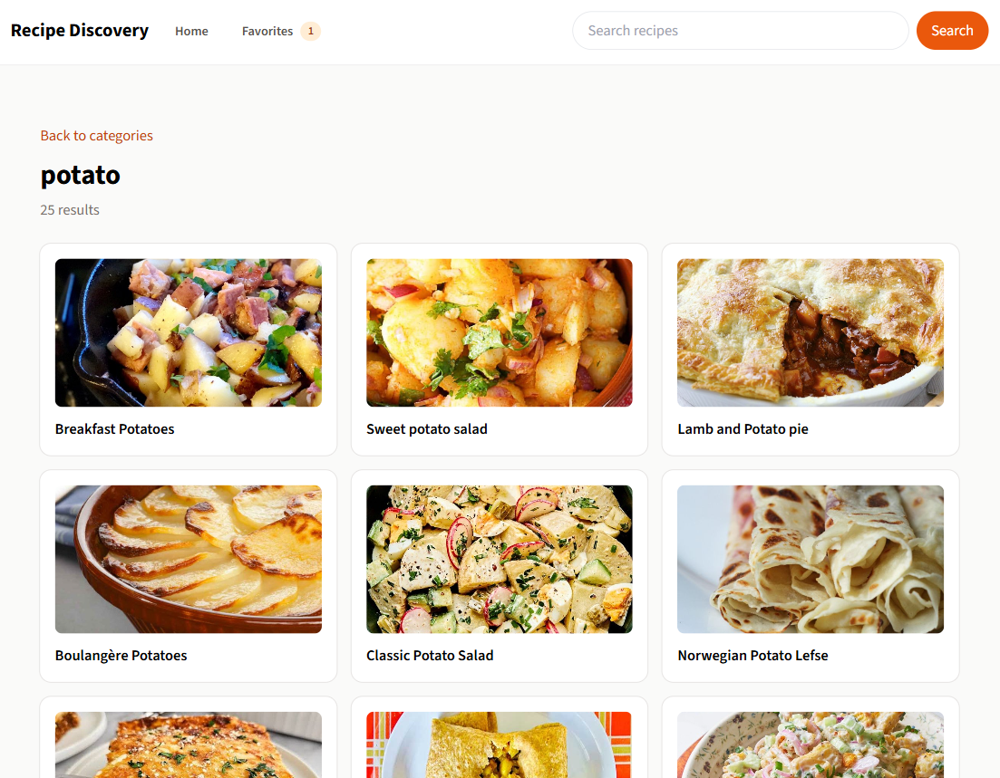
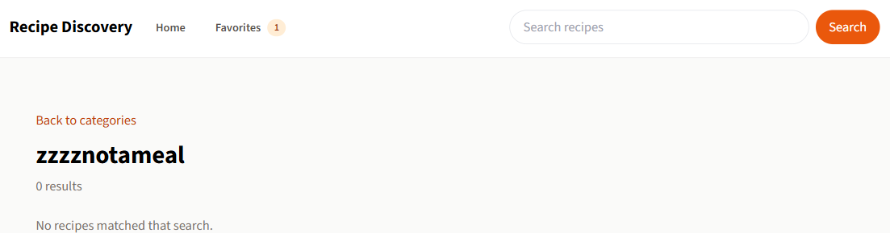

# SBA 7: Recipe Discovery App

A Vite, React, and TypeScript app. Recipes come from TheMealDB.

## Description

The tab title is "Recipe Discovery". Favorites are saved in this browser under the `localStorage` key `favoriteRecipeIds`. The page uses Source Sans 3. The background is stone, `rgb(250, 250, 249)`. The header stays at the top: the Recipe Discovery link, Home, Favorites, a search box, and an orange Search button. The footer reads "© 2026 Recipe Discovery App by Mamadou Moussa Balde. All rights reserved."

Home loads the category list. This run returned 14 categories: Beef, Chicken, Dessert, Lamb, Miscellaneous, Pasta, Pork, Seafood, Side, Starter, Vegan, Vegetarian, Breakfast, and Goat. Each card shows the photo, the name, and three lines of the description. The grid is one column, two columns from 640px, and three columns from 1024px. Home is the orange pill on this page.

A category link opens `/category/` plus the category name. Breakfast listed 19 recipes, and every photo loaded. The heading is the category name, with a count underneath and a link back to the categories.

A recipe card opens `/recipe/` plus the meal id. Breakfast Potatoes, id 52965, is labeled "Canadian · Breakfast". The page shows the photo, a YouTube embed when the meal has a video id, the ingredients with their measures, and the instructions with their line breaks. This recipe's video is `https://www.youtube.com/embed/BoD0TIO9nE4`. The ingredients are Potatoes 3 Medium, Olive Oil 1 tbs, Bacon 2 strips, Garlic Clove Minced, Maple Syrup 1 tbs, Parsley Garnish, Salt Pinch, Pepper Pinch, and Allspice To taste. The back link returns to that meal's category. An unknown id shows "Recipe not found."

Add to Favorites stores that meal id. The button changes to "Remove from Favorites", and the Favorites link shows the count. Opening Favorites loads each saved id and shows its card. Removing the recipe clears the count. With nothing saved, the page says "No favorites yet. Open a recipe and tap Add to Favorites."

Search trims the text and opens `/search?query=` with that text. The box is then cleared. A blank search stays on the current page. Opening `/search` with no query says "Type a recipe name to search."

Searching for `potato` returned 25 recipes. The heading is the query, followed by the count. Searching for `zzzznotameal` returned 0 results and the line "No recipes matched that search."

While a list is loading, the page shows an orange spinner. The labels are "Loading categories...", "Loading recipes...", "Searching...", and "Loading recipe...". If a request comes back not ok, the page says "Something went wrong" and "Request failed".

## Screenshots

### Categories





### A recipe





### Search





## Getting Started

### Dependencies

* Node.js and npm
* A network connection to TheMealDB

### Installing

```bash
npm install
```

### Executing program

```bash
npm run dev
```

Vite serves the app at http://localhost:5173/.

## Help

An unknown meal id shows "Recipe not found." A blank search stays on the current page. `/search` with no query says "Type a recipe name to search." A request that is not ok says "Something went wrong" and "Request failed". With nothing saved, Favorites says "No favorites yet. Open a recipe and tap Add to Favorites."

## Authors

[Mamadou Moussa Balde](https://www.linkedin.com/in/2mb/)

## Version History

* Current local run
    * Vite at http://localhost:5173/
    * 14 categories, Breakfast with 19 recipes, Breakfast Potatoes, and searches for `potato` and `zzzznotameal`

## License

This folder does not include a `LICENSE.md` file.

## Acknowledgments

* [TheMealDB](https://www.themealdb.com/)
* [Source Sans 3](https://fonts.google.com/specimen/Source+Sans+3)
* [README template](https://gist.github.com/DomPizzie/7a5ff55ffa9081f2de27c315f5018afc)
